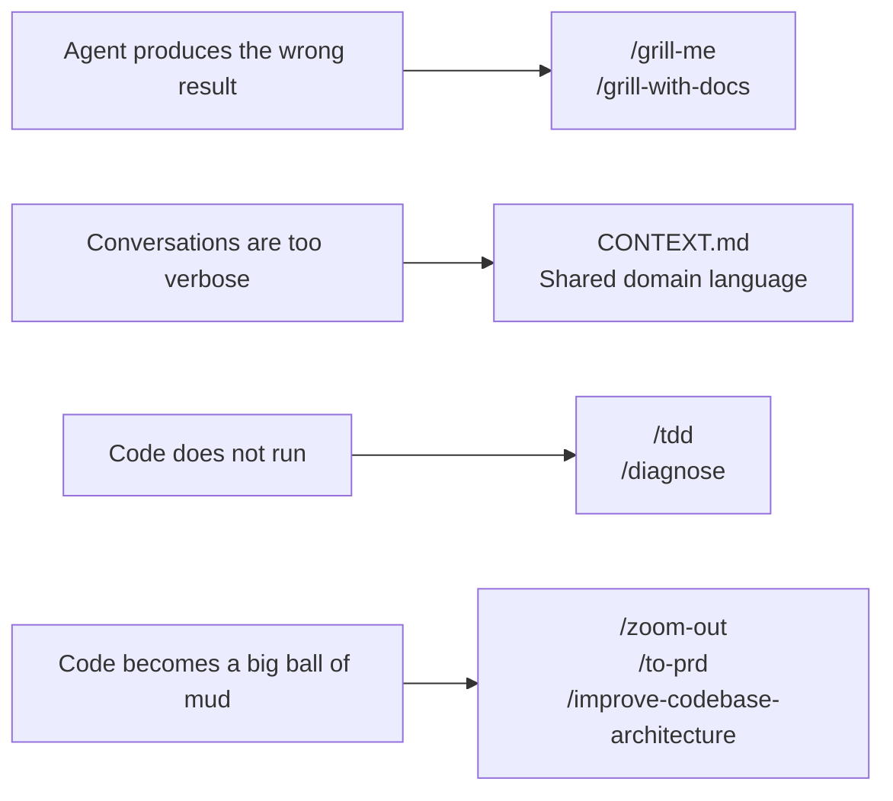
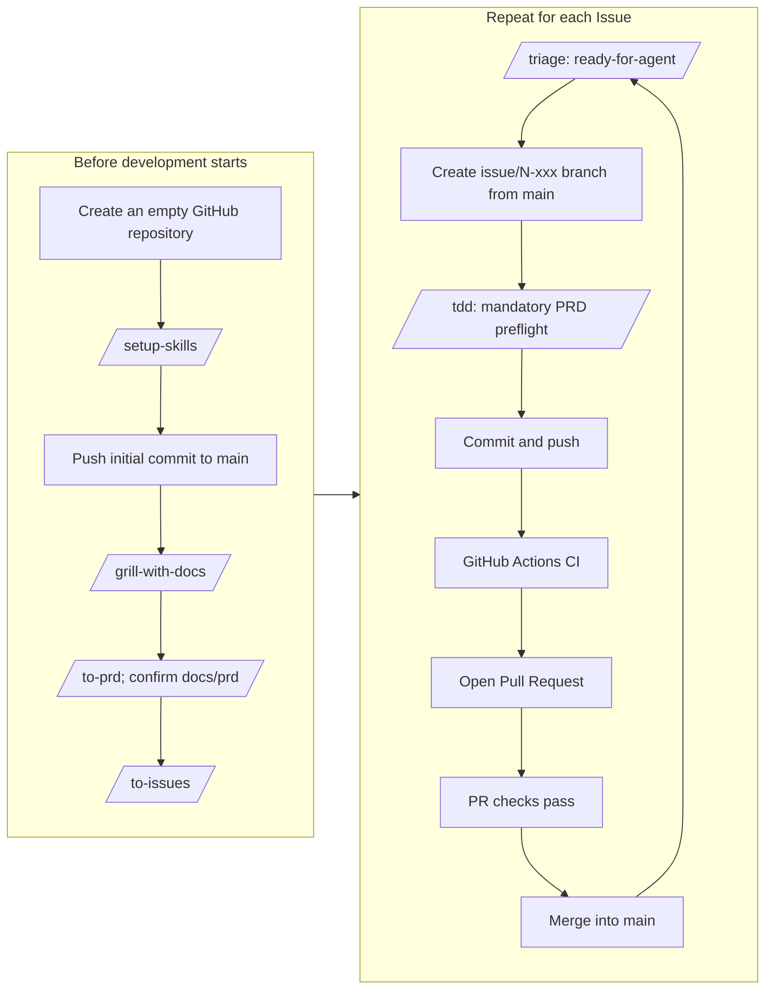
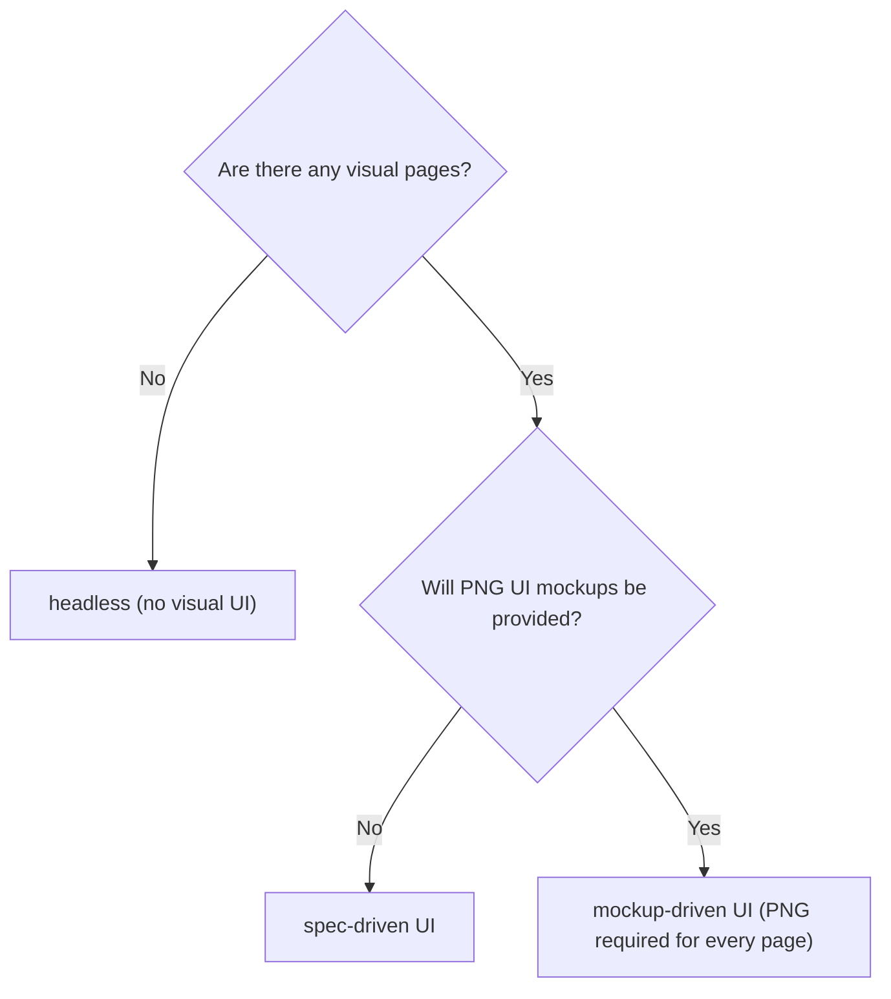

# A Comprehensive Practical Guide to Efficient, Collaborative, End-to-End AI Coding — V1.2

> **Intended audience:** Developers using AI coding assistants such as Cursor, Claude Code, or Codex who often feel that “the agent doesn't understand me,” “the code gets messier as I go,” or that UI quality is hard to control during development. This guide offers a **hands-on, end-to-end AI coding workflow**, from requirements alignment and collaboration to test-driven implementation, embedding sound software engineering practices into everyday AI coding.
>
> This guide builds on the open-source [mattpocock/skills](https://github.com/mattpocock/skills) project (170,000+ GitHub stars; MIT licence) and has been iteratively improved through practical experience.

## Version history

| Version | Date | Author | Changes |
| --- | --- | --- | --- |
| V1.0 | 2026-06-22 | Nan Ge (Bilibili and YouTube creator; handle: Nan Ge AGI Research Society) | Initial release: (1) translated the open-source Skills into Chinese and integrated practical experience; (2) added UI design governance to the overall workflow. |
| V1.1 | 2026-06-24 | Nan Ge (Bilibili and YouTube creator; handle: Nan Ge AGI Research Society) | (1) Adjusted `/to-issues`: Design Issues of types `#D-global` (global baseline) and `#D-templates` (page/state templates) are initially labelled `ready-for-agent`, allowing direct agent execution; (2) specified the `shop-book` full-stack booking and check-in example in Section 4.2 as a pet-grooming shop booking and verification system. |
| V1.2 (current) | 2026-07-06 | Nan Ge (Bilibili and YouTube creator; handle: Nan Ge AGI Research Society) | Major workflow revision: (1) `/setup-skills` now configures three items: Issue tracker, Triage labels and domain documentation; (2) `/grill-with-docs` follows a fixed interview order (domain → technology stack → UI mode and brand visual specifications); the redesigned three UI coding modes are selected after confirming the domain and technology stack and recorded in `DESIGN.md`; (3) `/to-prd` first writes a draft to `docs/prd` for local confirmation, with a redesigned PRD template; (4) `/to-issues` introduces PRD bindings, a States Matrix and layered Design Issues; (5) `/tdd` requires a mandatory PRD preflight check before coding, and implementation must strictly follow the PRD. |

---

## 1. What is this? In one sentence

This is an **end-to-end working method for AI coding assistants**. It is not a heavyweight framework that takes over everything for you. Instead, it breaks requirements alignment, planning, implementation, debugging and architecture maintenance into **small, composable steps** that are triggered progressively through conversational Skills.

The goal is clear: **real engineering**, not “vibe coding.” Each stage produces verifiable artefacts (a domain glossary, architecture decision records, `DESIGN.md`, PRDs, Issues, tests and PRs).

Unlike process-controlling, specification-driven development approaches such as GSD, BMAD and Spec-Kit, the design principles here are:

| Principle | Description |
| --- | --- |
| **Small** | Each Skill does one thing, lowering the barrier to adoption. |
| **Adaptable** | Workflows and Skills can be tailored to team conventions. |
| **Composable** | Workflow steps can be combined flexibly to suit actual needs, gradually completing the full development lifecycle. |
| **AI coding assistant agnostic** | Works with Cursor, Claude Code, Codex and others. |

---

## 2. Which four pain points does it solve?

The most common AI coding failure modes fall into four categories. This guide offers corresponding Skills and outputs for each:



### Pain point 1: The agent does not understand what you want

**Symptom:** You say, “Add a reminder feature,” but it builds something completely different from what you intended.

**Root cause:** Requirements were not aligned; a probing interview between the human and AI was missing.

**Solution:**

- `/grill-me` — Interview only; does not write documents. Suitable for product ideas and process design.
- `/grill-with-docs` — Conducts the same rigorous interview while maintaining `CONTEXT.md`, ADRs (Architecture Decision Records), and `docs/design/DESIGN.md` if UI is enabled.

### Pain point 2: Conversations and code are too verbose

**Symptom:** The agent uses 20 words for something that one domain term could express.

**Root cause:** The project lacks a shared vocabulary, and Issue descriptions repeat the entire PRD.

**Solution:** `CONTEXT.md` is the project's domain glossary. **PRD binding** uses numbered references in an Issue to direct the agent to the right PRD sections without duplicating the whole document. For example:

- ❌ “Add a task”; “mark it as finished.”
- ✅ “Add a **Todo**”; “mark it as **Done**.”

Once terminology is consistent, variable names, function names and test names become more consistent, and the agent uses fewer tokens.

### Pain point 3: The generated code does not run

**Symptom:** It looks correct but crashes when executed, or changing one thing breaks three others.

**Root cause:** The feedback loop is too weak; the agent is flying blind.

**Solution:**

- `/tdd` — Test-driven development with red–green–refactor and **vertical slices** (one test and its corresponding implementation at a time).
- `/diagnose` — A disciplined debugging cycle: reproduce → minimise → hypothesise → observe → fix → regression-test.

### Pain point 4: The codebase becomes a big ball of mud

**Symptom:** Features work, but developers become increasingly afraid to make changes.

**Root cause:** AI accelerates code generation and also accelerates **software entropy**.

**Solution:**

- `/zoom-out` — Have the AI explain unfamiliar code from a system-level perspective.
- `/to-prd` — Capture a PRD before major changes, specifying affected modules and acceptance criteria.
- `/improve-codebase-architecture` — Periodically refactor to create **deeper modules**.

---

## 3. What do you need to prepare?

| Requirement | Mandatory? | Description |
| --- | --- | --- |
| An AI coding assistant | ✅ Yes | Cursor, Claude Code, Codex, etc. |
| GitHub account | ✅ Yes | Host code, track Issues, and use the PR workflow (GitLab is also supported; see `/setup-skills`). |
| GitHub CLI (`gh`) | ✅ Yes | Use the GitHub API from a terminal (or agent) to create PRs and link Issues. |
| Git | ✅ Yes | Local version control. |
| Engineering Skills | ✅ Yes | The engineering Skill collection. |

### 3.1 Register on GitHub and set up SSH

1. Visit [https://github.com](https://github.com) and register.
2. Navigate to **Settings → SSH and GPG keys**.
3. If you do not have an SSH key, run:

```bash
ssh-keygen -t ed25519 -C "your-email@example.com"
```

Copy the public key:

**macOS:**

```bash
pbcopy < ~/.ssh/id_ed25519.pub
```

**Linux (requires `xclip`):**

```bash
xclip -sel clip < ~/.ssh/id_ed25519.pub
```

**Windows Git Bash:**

```bash
cat ~/.ssh/id_ed25519.pub | clip
```

Return to GitHub, click **New SSH key**, paste the public key and save it.

Test SSH:

```bash
ssh -T git@github.com
```

If successful, you should see a message similar to `Hi your-username!`.

### 3.2 Install Git

#### macOS

```bash
git --version
xcode-select --install
git --version
```

Seeing a result such as `git version 2.x.x` indicates success.

#### Windows

1. Download Git for Windows from [https://gitforwindows.org](https://gitforwindows.org).
2. Install using the default settings.
3. Open Git Bash or Command Prompt and run:

```bash
git --version
```

Seeing a result such as `git version 2.x.x.windows.x` indicates success.

#### Linux

**Ubuntu/Debian:**

```bash
sudo apt-get update
sudo apt-get install git
git --version
```

**CentOS/Fedora:**

```bash
sudo yum install git
git --version
```

### 3.3 Install GitHub CLI (`gh`)

#### macOS

```bash
gh --version
# If not installed, install it with:
brew install gh

# Authenticate after installation (SSH is recommended)
gh auth login

# If you encounter permissions issues, grant the current user access to the configuration directory
sudo chown -R "$(whoami):staff" ~/.config/gh

# Check authentication status
gh auth status
```

#### Windows

1. Visit [https://github.com/cli/cli/releases](https://github.com/cli/cli/releases) and download the Windows installer (`gh_*_windows_amd64.msi`).
2. Run the installer, then open Command Prompt or PowerShell and execute:

```bash
gh --version
```

3. Initialise and authenticate your GitHub account (SSH is recommended):

```bash
gh auth login
```

4. Check authentication status:

```bash
gh auth status
```

#### Linux

For Ubuntu/Debian:

```bash
# Install the latest gh version
type -p curl >/dev/null || sudo apt install curl -y
curl -fsSL https://cli.github.com/packages/githubcli-archive-keyring.gpg | sudo dd of=/usr/share/keyrings/githubcli-archive-keyring.gpg
sudo chmod go+r /usr/share/keyrings/githubcli-archive-keyring.gpg
echo "deb [arch=$(dpkg --print-architecture) signed-by=/usr/share/keyrings/githubcli-archive-keyring.gpg] https://cli.github.com/packages stable main" | sudo tee /etc/apt/sources.list.d/github-cli.list > /dev/null
sudo apt update
sudo apt install gh -y

# Authenticate after installation (SSH is recommended)
gh auth login

# Check authentication status
gh auth status
```

Seeing `gh version x.x.x` and a successful authentication status indicates that setup is complete.

### 3.4 Verify that Skills are ready

Before following the exercises, confirm that your AI coding assistant has enabled the engineering Skills used in this guide. If not, deploy them according to your environment—for example, create `.cursor/skills` in the root of a Cursor project and copy the full Skills package there.

| No. | Command | Category | In one sentence |
| --- | --- | --- | --- |
| 1 | `/hi-ai-coding` | Getting started | Introduction to AI coding for beginners: what it is; vibe coding versus controlled engineering; engineering basics; collaboration approaches; and an end-to-end workflow tour (optionally producing a learning report). |
| 2 | `/setup-skills` | Engineering | Run once per repository to configure the Issue tracker (GitHub/GitLab/local Markdown), Triage labels and domain documentation layout. |
| 3 | `grill-with-docs` | Engineering | Probe the proposed solution and maintain `CONTEXT.md`, ADRs and `DESIGN.md`, including the selected UI mode and brand visual specifications. |
| 4 | `grill-me` | Productivity | A pure probing interview; does not write repository documentation. |
| 5 | `to-prd` | Engineering | Write and confirm a draft under `docs/prd`, then publish a PRD Issue (including state strategy, page inventory and app-shell). |
| 6 | `to-issues` | Engineering | Use the PRD page inventory as the SSOT to create vertical slices and Design Issues; include PRD bindings and a States Matrix in Issues. |
| 7 | `tdd` | Engineering | Mandatory PRD preflight check before coding, followed by red–green–refactor vertical slices. |
| 8 | `diagnose` | Engineering | A disciplined debugging cycle. |
| 9 | `triage` | Engineering | Classify Issues through a state machine and prepare an agent brief (copying mandatory PRD reading verbatim). |
| 10 | `improve-codebase-architecture` | Engineering | Identify architectural refactoring opportunities that deepen modules. |
| 11 | `zoom-out` | Engineering | Understand unfamiliar code at a higher level of abstraction. |

---
## 4. Hands-on walkthrough: the complete development loop

This section presents **two complete hands-on examples**. Both follow the same AI coding lifecycle (project initialisation → requirements alignment → PRD → Issues → branches + TDD + push + CI + PR → merge), but with increasingly complex scenarios.



| Example | Project | Best for | Issue tracking | Hosting and merge workflow |
| --- | --- | --- | --- | --- |
| **4.1** | Command-line `todo-cli` | First-time users who want to complete the development loop quickly. | GitHub Issues | One branch per Issue → push → CI → PR → merge. |
| **4.2** | Full-stack `shop-book` (pet-grooming shop booking and verification system) | Users who completed Example A and want to practise collaboration across a backend API, web admin dashboard and mobile WeChat mini-program. | GitHub Issues | Monorepo; one branch per Issue → push → CI → PR → merge. |

### 4.1 Command-line todo list: `todo-cli`

#### What the sample project looks like (v1 goals)

| Capability | Example command | Description |
| --- | --- | --- |
| Add a todo | `todo add "Buy milk"` | Creates a **Todo**. |
| List todos | `todo list` | Shows all **Todos**, distinguishing **Open** and **Done**. |
| Mark as done | `todo done 1` | Marks the todo with the given index as completed. |

**Deliberately out of scope for v1** (recorded under “Out of scope” in the PRD): web interface, multiple users, cloud synchronisation and database. A local JSON file is sufficient initially.

You can allow the agent to recommend the technology stack or specify it during the interview.

#### Stage 1: Create GitHub and local repositories; initialise the project — `/setup-skills`

**First create an empty repository** named `todo-cli` on the GitHub website (do not initialise it with a README). Then create the local repository:

```bash
# 1. Create an empty directory and initialise Git
mkdir todo-cli && cd todo-cli
git init

# 2. Open this folder in Cursor
cursor .
```

Next, run the project setup. It will ask about your Issue tracker, Triage labels and domain documentation layout. **Do not configure the UI coding mode here**; that choice is made in `/grill-with-docs`.

**Natural-language interaction (in Cursor):**

```text
/setup-skills
```

| Step | Question | Recommended beginner choice |
| --- | --- | --- |
| A | Where should Issues be tracked? | **GitHub is recommended for this walkthrough**, because GitHub tracking and PRs make changes easier to review. Use GitLab for GitLab repositories; Local Markdown is an option for fully offline practice but is not recommended. |
| B | What should the Triage labels be? | Accept the defaults on your first run; UI projects will later use a `design-input` category label. |
| C | Where should domain documents live? | Default: root-level `CONTEXT.md` and `docs/adr/`. |

After completion, the following files will be generated:

```text
your-project/
├── AGENTS.md or CLAUDE.md     ← Add the agent Skills configuration block; Cursor uses AGENTS.md
└── docs/agents/
    ├── issue-tracker.md       ← Issue tracking method
    ├── triage-labels.md       ← Label glossary
    └── domain.md              ← Domain documentation layout
```

**Run once per repository.** To change settings later, edit `docs/agents/*.md` directly. **Finally, push the setup to GitHub.** Either commands or natural language can be used, but natural-language interaction is recommended throughout.

**Manual commands (not recommended):**

```bash
# Run these commands in sequence
git remote add origin git@github.com:<your-username>/todo-cli.git
git add docs/ AGENTS.md CLAUDE.md 2>/dev/null; git add -A
git commit -m "chore: initial project setup"
git branch -M main
git push -u origin main
```

**Natural-language instruction (in Cursor):**

```text
Connect the GitHub remote git@github.com:<your-username>/todo-cli.git,
commit the changes, and push to main for the first time.
```

#### Stage 2: Align before implementation — `/grill-with-docs`

**Natural-language instruction (in Cursor):**

```text
/grill-with-docs

I want to build a command-line todo list called todo-cli from scratch.
For v1, I only need to add todos, list todos and mark todos as done.
Store the data in a local JSON file for now. Keep questioning me until the solution is clear.
```

**What to expect:**

1. The agent asks **one question at a time** and offers a recommended answer.
2. The **fixed interview sequence** is domain specifications → technical specifications (a 14-item technology-stack baseline; decisions warranting an ADR go into `docs/adr/`) → UI specifications. This example is a CLI, so it selects **headless** mode (no visual UI) and does not create `docs/design/`.
3. The agent pushes you to turn vague expressions into precise terms.
4. Whenever a term is agreed, it is **immediately created and written** into `CONTEXT.md`, the first domain document in the previously empty repository.
5. Hard-to-reverse decisions are recorded as **ADRs**, for example `docs/adr/0001-v1-cli-only-no-web.md`.

**Your responsibilities:**

- Answer each question carefully; if unsure, say “Accept your recommendation.”
- Review each update to `CONTEXT.md`. When starting a project from scratch, this document is your project's “constitution.”
- **Do not write code yet.** Starting without a glossary will cause naming and testing to drift later.

**After confirming, tell Cursor:**

```text
Commit and push to main.
```

#### Stage 3: Capture requirements — `/to-prd`

**After alignment, tell Cursor:**

```text
/to-prd

Turn our discussion of todo-cli v1 into a PRD.
```

The agent **first creates a local PRD draft in `docs/prd/`** for your review and adjustments. As a headless CLI project, it does not need a “state strategy” or page inventory. Once confirmed, publish the PRD as a GitHub Issue. Check the repository's **Issues** page to confirm the PRD Issue exists and review it. You may also ask the agent about progress through normal conversation.

**Natural-language instruction (in Cursor):**

```text
Please verify whether the PRD Issue has been created in GitHub Issues,
and list its title and number.
```

**After confirming, tell Cursor:**

```text
Commit and push to main.
```

#### Stage 4: Break down the work — `/to-issues`

When building from scratch, **strongly prefer splitting the work into Issues** rather than asking the agent to “build the entire project” in one go.

**Natural-language instruction (in Cursor):**

```text
/to-issues

Break the todo-cli v1 PRD into vertical slices.
```

The resulting slices should look something like this, each runnable and independently verifiable:

| Issue | Vertical slice | Acceptance method |
| --- | --- | --- |
| #1 | PRD documentation | The PRD Issue has been published on GitHub. |
| #2 | Project scaffolding + `todo add` | After `todo add "Buy milk"`, the data is written to `todos.json`. |
| #3 | `todo list` | Lists todos and distinguishes Open from Done. |
| #4 | `todo done <index>` | Marks the specified index as Done, and `list` shows the state change. |

Each functional Issue includes a **PRD binding** (Seam + **three mandatory PRD readings** + covered user stories) and **acceptance criteria** (each with a **PRD basis**). The Issue **does not copy** the entire PRD.

**Do not** create “#1 Write all tests” and “#2 Write all implementation.” These are horizontal slices and conflict with the `/tdd` cadence.

After splitting the work, check Issue counts and acceptance criteria on GitHub's **Issues** page. Once confirmed, Issues will be created on GitHub in dependency order.

**Natural-language instruction (in Cursor):**

```text
The breakdown looks reasonable. Create the Issues.
```

#### Stage 5: Write the code — branch + `/triage` + `/tdd` + PR

Start with **Issue #2** (Issue #1 contains the PRD). For **each Issue**, follow: **triage → create branch → TDD → push → CI → PR → merge**.

**Step 0: Triage the Issue (if it is not already `ready-for-agent`)**

Skip this step if `/to-issues` has already applied the correct label. Otherwise:

```text
/triage

Move todo-cli Issue #[num] to ready-for-agent and write the agent brief.
(Alternatively, do this manually in the Issue tracker.)
```

**Step 1: Create a branch for Issue #2**

**Manual commands (not recommended):**

```bash
git checkout main && git pull origin main
git checkout -b issue/2-todo-list
```

**Natural-language instruction (in Cursor):**

```text
Create a new branch from the latest main to implement
todo-cli GitHub Issue #[num].
```

**Step 2: Run `/tdd` in the current conversation or a new one**

**Natural-language instruction (in Cursor):**

```text
/tdd

Implement this Issue.
```

`/tdd` first opens the relevant PRD sections specified by the Issue's **three mandatory PRD readings**, then begins the red–green–refactor cycle. Each RED iteration closely reviews the PRD based on the **PRD basis** recorded in the acceptance criteria.

**Example TDD cadence for the first slice:**

```text
RED   → Test: with two Open todos in todos.json, running list displays both as Open.
GREEN → Implement: read todos.json and format the output.
RED   → Test: after one todo becomes Done, list distinguishes Open and Done.
GREEN → Implement: state-dependent display logic.
```

**The cadence enforced by `/tdd`:**

```text
✅ Correct (vertical slices):
   Issue #1: test 1 → implementation 1 → pass → ... → add command works
   Issue #2: test 1 → implementation 1 → pass → ... → list command works
   Issue #3: ...

❌ Incorrect (horizontal slices):
   Build the full directory structure + write all tests +
   implement all three commands in one batch.
```

In each iteration, add **only enough code to pass the current test**. After TDD, you can run the application locally for testing.

**Natural-language instruction (in Cursor):**

```text
Run the application locally.
```

**Step 3: Configure CI**

Issue #2 produces test scripts. **On the same branch**, add a GitHub Actions workflow so the tests run automatically in the cloud after pushing.

**Natural-language instruction (in Cursor):**

```text
[One-time setup] Configure whether CI should run on pushes to any branch
and on pull requests.
```

**Step 4: Push and wait for CI to turn green**

**Manual commands (not recommended):**

```bash
git add .
git commit -m "feat: todo list command and CI

Closes #2"
git push -u origin issue/2-todo-list
```

**Natural-language instruction (in Cursor):**

```text
Commit and push.
```

Pushing automatically triggers CI. In GitHub → **Actions**, confirm the most recent **CI** workflow run shows ✅. If it fails, provide the Actions logs to `/diagnose`. The code has not yet been merged into `main`; you must open a PR.

**Natural-language instruction (in Cursor):**

```text
Create a PR.
```

The PR also triggers CI. In GitHub → **Actions**, confirm the latest **CI** run shows ✅. If it fails, share the Actions logs with `/diagnose`. You can also ask for the CI status in natural language.

**Natural-language instruction (in Cursor):**

```text
Confirm whether CI passed. If it failed, summarise the cause
and recommend a fix.
```

Once the PR is ready, merge the code into `main`.

**Natural-language instruction (in Cursor):**

```text
Merge this PR into main without deleting the branch,
and confirm that the Issue has been closed.
```

Wait until every **Check** on the PR page is green before selecting **Merge pull request**. Repeat for Issues #3, #4 and so on: new branch → `/tdd` → push → **wait for CI** → PR → merge. This keeps conversations cleaner and the history auditable.

#### Stage 6: When things go wrong — `/diagnose`

A typical problem while building from scratch:

**Natural-language instruction (in Cursor):**

```text
/diagnose

todo list crashes when todos.json is empty.
Fix it using the diagnostic cycle.
```

The Skill walks through: reproduce → narrow the scope → propose hypotheses → observe → verify → fix → add a regression test. **Do not let it start making speculative code changes immediately.**

#### Stage 7: Maintenance after v1 works — `/improve-codebase-architecture`

After finishing v1, or every three to four days, run this Skill to maintain the codebase:

```text
/improve-codebase-architecture

todo-cli v1 now works. Look for opportunities to make modules deeper
and narrow their interfaces.
```

You can start this **on day one of a new project**; there is no need to wait until the code becomes a big ball of mud. **Invest in design from the first version** instead of piling on features and paying down the debt later.

Optional: If you are unfamiliar with the call relationships, run `/zoom-out` first to draw a system diagram.

**Natural-language instruction (in Cursor):**

```text
/zoom-out

Draw the relationships between the todo-cli modules.
Do not write code.
```

### 4.2 Full-stack shop booking and verification: `shop-book` (backend + admin dashboard + WeChat mini-program)

Build a **multi-platform** shop booking system from scratch. Customers choose time slots and book through a WeChat mini-program. Staff view appointments through a web-based admin dashboard and **verify/check in** customers when they arrive.

#### What the sample project looks like (v1 goals)

**Core business flow (one happy path for v1):**

```text
Customer selects "Premium Grooming Service" in the mini-program
  → selects an available slot → submits booking (Pending)
        ↓
Staff sees the new booking in the admin dashboard
  → customer arrives → staff clicks "Verify" → status becomes Verified
        ↓
In the customer's "My Bookings" mini-program screen,
  the booking now displays "Verified".
```

#### Stage 1: Create GitHub and local repositories; initialise the project — `/setup-skills`

**First create an empty GitHub repository** named `shop-book` (without a README), then create the local repository:

```bash
# 1. Create an empty directory and initialise Git
mkdir shop-book && cd shop-book
git init

# 2. Open this folder in Cursor
cursor .
```

Then configure the project. The Skill asks about the Issue tracker, Triage labels and domain documentation layout. **UI coding mode is not chosen here**; select it later in `/grill-with-docs`.

**Natural-language instruction (in Cursor):**

```text
/setup-skills
```

| Step | Question | Recommended beginner choice |
| --- | --- | --- |
| A | Where should Issues be tracked? | **GitHub is recommended.** A multi-platform project produces more Issues over a longer period, and GitHub Issues + PRs make review easier. |
| B | What should the Triage labels be? | Accept the defaults on your first run; UI projects will later use `design-input`. |
| C | Where should domain documents live? | Root-level `CONTEXT.md` and `docs/adr/`, shared by all three platforms. |

After completion, the project contains:

```text
your-project/
├── AGENTS.md or CLAUDE.md     ← Add the agent Skills configuration block; Cursor uses AGENTS.md
└── docs/agents/
    ├── issue-tracker.md       ← Issue tracking method
    ├── triage-labels.md       ← Label glossary
    └── domain.md              ← Domain documentation layout
```

**Run once per repository.** To update the configuration, edit `docs/agents/*.md` directly. **Finally, push to GitHub**, using commands or natural language. Natural language is recommended throughout.

**Manual commands (not recommended):**

```bash
# Run these commands in sequence
git remote add origin git@github.com:<your-username>/shop-book.git
git add docs/ AGENTS.md CLAUDE.md 2>/dev/null; git add -A
git commit -m "chore: initial project setup"
git branch -M main
git push -u origin main
```

**Natural-language instruction (in Cursor):**

```text
Connect the GitHub remote git@github.com:<your-username>/shop-book.git,
commit the changes, and push to main for the first time.
```

#### Stage 2: Align before implementation — `/grill-with-docs`

**Natural-language instruction (in Cursor):**

```text
/grill-with-docs

I want to build a pet-grooming shop booking and verification system
called shop-book from scratch. V1 includes:
- A backend REST API
- A web admin dashboard (staff view and verify bookings)
- A WeChat mini-program (customers select slots, book and view verification status)

Core flow: customer booking → staff verification → mini-program status update.
Keep questioning me until the solution is clear.
```

**What to expect:**

1. The agent asks **one question at a time**.
2. The **fixed interview sequence** is domain specifications → technical specifications (14 technology-stack baseline items) → UI specifications (select UI coding mode and brand visual standards).
3. It pushes you to convert vague language into precise terminology.
4. Every confirmed term is **immediately created and written** to `CONTEXT.md`, the first domain document in the empty repository.
5. Hard-to-reverse choices become **ADRs**, for example `docs/adr/0001-booking-state-pending-verified-only.md`.
6. The **UI mode interview** selects one of three modes, recorded at the beginning of `docs/design/DESIGN.md`:

| Mode | When to choose it | Design inputs |
| --- | --- | --- |
| **headless** (no visual UI) | Pure APIs, CLI tools or libraries without visual pages. | Do not create `docs/design/`. |
| **spec-driven UI** | Web/mini-program/H5 pages are needed, and **no PNG mockups will ever be provided**. | `DESIGN.md` + “UI Design Description” in the PRD page inventory. |
| **mockup-driven UI** | Visual pages exist and **all UI pages must have PNG mockups**. | `DESIGN.md` + `references/*.png`. |



7. After **brand visual specifications** are confirmed, lazily create `docs/design/DESIGN.md` (design tokens, reusable UI primitives in §5, dos and don'ts in §6). For multi-platform work, also create `docs/design/platforms.md`.
8. **Page-specific functional specifications do not belong in `DESIGN.md`.** In mockup-driven mode, PNG files carry them; in spec-driven mode, `/to-prd` records them in the PRD page inventory.

**Your responsibilities:**

- Answer each question thoughtfully; if unsure, say “Accept your recommendation.”
- Review every update to `CONTEXT.md`; it is the “constitution” of a new project.
- **Do not write code yet.** Starting without a shared glossary will cause naming and test behaviour to drift.

**After confirming, tell Cursor:**

```text
Commit and push to main.
```

#### Stage 3: Capture requirements — `/to-prd`

**After alignment, tell Cursor:**

```text
/to-prd

Turn our discussion of shop-book v1 into a PRD.
```

The agent **first creates a local PRD draft under `docs/prd/`** for review. A PRD for a non-headless UI project **must include**:

- **State Strategy** — global conventions for loading, empty, error and other states, placed before the page inventory.
- **App-shell first on every platform** — the first page-inventory entry for every `platform-id` must be the platform's overall shell page.
- **Page Inventory** — each page has a `page-id` and **UI Design Description** (the coding SSOT in spec-driven mode; in mockup-driven mode, also state the plan for its default-state mockup).
- **User Story ↔ Page Mapping Table**.

After confirming the draft, publish the PRD to a GitHub Issue. Check the **Issues** page to verify the PRD Issue was created and review it. You can also ask the agent about progress conversationally.

**Natural-language instruction (in Cursor):**

```text
Please verify whether the PRD Issue has been created in GitHub Issues,
and list its title and number.
```

**After confirming, tell Cursor:**

```text
Commit and push to main.
```

#### Stage 4: Break down the work — `/to-issues`

When building from scratch, **strongly prefer individual Issues** instead of asking the agent to build the whole application at once.

**Natural-language instruction (in Cursor):**

```text
/to-issues

Break the shop-book v1 PRD into vertical slices.
```

**Use the PRD Page Inventory as the SSOT; do not redefine the UI pages.** In addition to functional vertical slices, this example requires:

| Issue type | Description | Initial status |
| --- | --- | --- |
| **Design Issue** `#D-global` | Validate and close out `DESIGN.md` (and `platforms.md` for multi-platform projects). | `ready-for-agent` |
| **Design Issue** `#D-xxx` | Mockup-driven only: one default-state PNG per page. | `ready-for-agent` when the mockup is available. |
| **UI Issue** | Complete logical states for one `page-id`; includes **seven mandatory PRD readings** + **States Matrix**. | `ready-for-agent` when all inputs are available. |
| **Functional Issue** | API, schema and other work; includes **three mandatory PRD readings** + acceptance criteria with a **PRD basis** for each. | `ready-for-agent` when the specifications are complete. |

**Design Issue layering and dependencies:**

```text
#D-global (validate DESIGN.md)
    ↓
#D-xxx (mockup-driven only: one default-state PNG per page)
    ↓
app-shell UI Issue (overall shell for each platform, before functional pages)
    ↓
Functional UI Issues / API slices (API work can run in parallel with #D-global)
```

- **spec-driven UI:** No `#D-xxx` Issues; the layout SSOT lives in the PRD Page Inventory's “UI Design Description.”
- UI Issues for functional pages **must depend on the app-shell UI Issue for the same platform**.

Check the number of Issues and acceptance criteria on GitHub's **Issues** page. After confirmation, create Issues in dependency order.

**Natural-language instruction (in Cursor):**

```text
The breakdown looks reasonable. Create the Issues.
```

#### Stage 5: Write the code — branch + `/triage` + `/tdd` + PR

Start with a **Design Issue or the first Functional Issue**. For **each Issue**, follow: **triage → branch → TDD → push → CI → PR → merge**. Backend API slices can run **in parallel** with `#D-global`, because backend code does not depend on UI mockups.

**Step 0: Triage the Issue (if it is not yet `ready-for-agent`)**

```text
/triage

Move shop-book Issue #[num] to ready-for-agent.
Copy the mandatory PRD readings verbatim into the agent brief.
(Alternatively, do this manually in the Issue tracker.)
```

**Step 1: Create a branch for the Issue**

**Manual commands (not recommended):**

```bash
git checkout main && git pull origin main
git checkout -b issue/2-slot-api
```

**Natural-language instruction (in Cursor):**

```text
Create a new branch from the latest main to implement
shop-book GitHub Issue #[num].
```

**Step 2: Run `/tdd` in the current conversation or a new one**

**Natural-language instruction (in Cursor):**

```text
/tdd

Implement this Issue.
```

- **Functional Issue:** Before coding, open the PRD sections specified by the **three mandatory PRD readings**; in every RED cycle, read the PRD using the acceptance criterion's **PRD basis**.
- **UI Issue:** Before coding, open the PRD/design sections specified by the **seven mandatory PRD readings**; in every RED cycle, consult the **PRD Source** column of the **States Matrix**. After the tests pass, the PR must also pass **design QA**.

**Step 3: Configure CI**

Issue #2 produces test scripts. Add a GitHub Actions workflow **on the same branch** so cloud tests run automatically after pushes.

**Natural-language instruction (in Cursor):**

```text
[One-time setup] Create CI and configure whether it should run
on pushes to any branch and on pull requests.
```

**Step 4: Push and wait for CI to turn green**

**Manual commands (not recommended):**

```bash
git add .
git commit -m "feat: slot API and CI

Closes #2"
git push -u origin issue/2-slot-api
```

**Natural-language instruction (in Cursor):**

```text
Commit and push.
```

Pushing triggers CI automatically. In GitHub → **Actions**, confirm the latest **CI** workflow run shows ✅. If it fails, give the Actions logs to `/diagnose`. The code has not yet been merged into `main`; open a PR.

**Natural-language instruction (in Cursor):**

```text
Create a PR.
```

The PR triggers CI again. Verify the latest **CI** run is ✅ in GitHub → **Actions**. On failure, provide the logs to `/diagnose`. Alternatively, ask the agent about CI status.

**Natural-language instruction (in Cursor):**

```text
Confirm whether CI passed. If it failed, summarise the cause
and recommend a fix.
```

After the PR is ready, merge it into `main`.

**Natural-language instruction (in Cursor):**

```text
Merge this PR into main without deleting the branch,
and confirm that the Issue has been closed.
```

Wait for every **Check** on the PR page to turn green before merging into `main`. Repeat for each remaining Issue: new branch → `/tdd` → push → **wait for CI** → PR → merge. This keeps sessions clean and history reviewable.

#### Stage 6: When things go wrong — `/diagnose`

A typical problem when building from scratch:

**Natural-language instruction (in Cursor):**

```text
/diagnose

The admin dashboard shows that verification succeeded,
but "My Bookings" in the mini-program still displays Pending.
Investigate systematically along three paths: API response,
admin request and mini-program cache.
```

The Skill walks through: reproduce → narrow the scope → hypothesise → observe → verify → fix → add a regression test. **Do not allow immediate speculative fixes.**

#### Stage 7: Maintenance after v1 works — `/improve-codebase-architecture`

Once v1 is complete, or every three to four days, use this Skill for maintenance:

```text
/improve-codebase-architecture

shop-book v1 now works. Look for opportunities to make modules deeper
and interfaces narrower.
```

This can be done **from the first day of a new project**. Do not wait for the codebase to become a big ball of mud. **Invest in design from version one**, rather than accumulating features chaotically and paying the debt later.

Optional: If the call relationships are unfamiliar, use `/zoom-out` to draw a system diagram first.

**Natural-language instruction (in Cursor):**

```text
/zoom-out

Draw the module relationships among the three shop-book platforms
and the API. Do not write code.
```

---
## 5. Core terminology

> This section explains concepts that recur throughout the guide and may be unfamiliar to beginners.

| Term | In one sentence | Related command or file |
| --- | --- | --- |
| `CONTEXT.md` | Domain glossary that standardises terminology between humans and AI. | `/grill-with-docs` |
| ADR | Architecture Decision Record, documenting hard-to-reverse technical decisions. | `/grill-with-docs` → `docs/adr/` |
| `DESIGN.md` | Brand visual SSOT: tokens, reusable UI primitives, dos and don'ts. | `/grill-with-docs` → `docs/design/` |
| PRD binding | Numbered references that direct the agent to PRD sections without repeating the full PRD in an Issue. | `/to-issues` → Issue body |
| Mandatory PRD readings | A compulsory reading list in the PRD binding (7 items for UI; 3 for functional work). | `/triage`, `/tdd` |
| States Matrix | One row per UI state, with its PRD source and observable expectation. | `/to-issues` → `/tdd` RED cycle |
| app-shell | The overall shell page for each platform; a dependency for functional-page UI Issues. | `/to-prd` Page Inventory → `/to-issues` |
| TDD | Test-driven development using red–green–refactor vertical slices. | `/tdd` |
| Software entropy | The tendency for codebases to become disorganised over time. | `/improve-codebase-architecture` |
| Triage labels | State markers used to route Issues. | `/triage` → `docs/agents/triage-labels.md` |
| AFK / HITL | Whether an agent can complete work unattended or requires a human in the loop. | `/triage`, `/to-issues` |
| Monorepo | Multiple subprojects sharing one Git repository. | Example B, `shop-book` → `docs/adr/` |
| pnpm | Package manager commonly used with monorepos. | `pnpm-workspace.yaml`, `pnpm test` |
| CI | Automated testing checks after pushing code. | GitHub Actions → `.github/workflows/` |
| PR | Request to review code changes before merging. | `gh pr create`, GitHub Pull Request page |

### 5.1 `CONTEXT.md` — a glossary, not a requirements document

**Include only:** domain nouns, definitions, ambiguous expressions to avoid, and relationships among concepts.

**Do not include:** API/interface design, database schemas or technology selection (those belong in ADRs or code), or brand visual specifications (those belong in `docs/design/DESIGN.md`).

A good entry looks like this (an excerpt from `CONTEXT.md` after the walkthrough; the example uses the shop booking domain):

```markdown
**Shop:**
A physical location that offers bookable time slots. V1 serves only one shop;
there is no shop selection or switching. Opening hours are 10:00–20:00,
seven days a week.
_Avoid:_ Store, Outlet

**TimeSlot:**
A bookable time window automatically generated from shop opening hours.
In v1, each slot lasts 60 minutes, has capacity for five customers, and
bookings are open for the next 14 days. A slot tracks remaining capacity;
each customer booking uses one place.
_Avoid:_ Period, Schedule
```

### 5.2 ADR — record only “hard-to-reverse decisions”

An **ADR (Architecture Decision Record)** is a short Markdown document that states **which option the team chose for a technical or architectural question, and why**.

Code tells you *what* was done; an ADR explains *why*. When a new colleague reads the implementation six months later, they should not have to wonder, “Why did we choose JSON instead of a database?”

**Separation of responsibilities from `CONTEXT.md`:**

| Document | What it records | What it does not record |
| --- | --- | --- |
| `CONTEXT.md` | Domain terminology and definitions. | Technology choices, API design, visual specifications. |
| `docs/adr/` | Hard-to-reverse technical and architectural choices. | Everyday business terminology or brand visuals. |
| `docs/design/DESIGN.md` | Brand visual tokens, shared UI primitives, dos and don'ts. | Page names, business-field layouts, domain terms. |

**Write an ADR only when all three criteria apply; otherwise skip it:**

1. **Hard to reverse** — changing it later would be expensive.
2. **Surprising without context** — a future maintainer would ask, “Why was it done this way?”
3. **A real trade-off** — alternatives were considered, and one was chosen.

An ADR is not mandatory on day one. `/grill-with-docs` **creates ADRs lazily** during solution discussions, only when a genuinely hard-to-reverse choice is confirmed. Example (`docs/adr/0001-typescript-monorepo.md`):

```markdown
# All-TypeScript Monorepo Architecture

shop-book v1 includes three components: a REST API, web admin dashboard,
and WeChat mini-program. They share domain types for bookings, time slots
and states. We use pnpm workspace + Turborepo to organise `apps/api`,
`apps/admin-web`, `apps/miniapp` and `packages/shared`. A unified TypeScript
toolchain prevents DTO definitions from diverging across the three platforms.
We considered a native WeChat mini-program and a Vue admin dashboard, but
selected Taro 3 + React and a React admin dashboard to maximise type reuse
and collaboration efficiency.
```

### 5.3 TDD — Test-Driven Development

**TDD (Test-Driven Development)** means **writing tests before implementation**, using those tests as an executable specification of behaviour.

**Red–green–refactor cycle:**

1. **RED** — Write a failing test describing the behaviour the system should have.
2. **GREEN** — Write the **minimum amount of code needed** to pass that test.
3. **REFACTOR** — Once tests are green, improve the structure while keeping all tests passing.

**Test behaviour, not implementation details.** Verify observable results through public interfaces rather than testing private functions or internal data structures. That way, tests should continue to pass after a behaviour-preserving refactor.

**Vertical versus horizontal slices** (`/tdd` enforces vertical slicing):

```text
❌ Incorrect (horizontal slices):
   Write test1, test2, test3 → then write impl1, impl2, impl3

✅ Correct (vertical slices):
   test1 → impl1 → pass → test2 → impl2 → pass → ...
```

**Mandatory PRD preflight before coding** (new gate in V1.2):

| Issue type | Preflight checklist | Basis for the RED cycle |
| --- | --- | --- |
| **UI implementation** | **Seven mandatory PRD readings** + `DESIGN.md` (plus `platforms.md` for multi-platform work and mockup `references/` where applicable). | **PRD Source** column of the States Matrix. |
| **Functional / headless** | **Three mandatory PRD readings**. | **PRD basis** in acceptance criteria. |

If the Issue is not `ready-for-agent`, or dependencies are unmet, **stop**; do not run `/tdd`.

```text
RED   → Test: after running add, todos.json contains one additional Open todo.
GREEN → Implement: minimal CLI argument parsing and file writing.
RED   → Test: after two add operations, the file contains two separate
        todos, each with an Index.
GREEN → Implement: incrementing index logic.
```

### 5.4 Software entropy — why codebases turn into a big ball of mud

**Software entropy** borrows a metaphor from physics: **disorder naturally increases over time unless energy is deliberately spent restoring order**.

In code, features may continue to work while the costs of understanding and modifying the system, and the likelihood of bugs, keep growing. “Every change feels dangerous” is a typical symptom.

**Common signs:**

- Unclear module boundaries: one change affects many areas (big-ball-of-mud code).
- Copy-pasted logic scattered across the codebase.
- Drifting names and concepts that newcomers cannot understand.
- Brittle or missing tests that make refactoring risky.
- Temporary “good enough for now” workarounds becoming permanent.

**Why entropy accelerates:** changing requirements, time pressure, staff turnover and **AI-assisted code generation**. Without `CONTEXT.md`, ADRs, TDD and periodic architecture reviews, agents can accumulate complexity faster.

**Countermeasures (the guide's “negative-entropy work”):**

| Practice | Purpose |
| --- | --- |
| `CONTEXT.md` | Stabilise domain language and prevent conceptual drift. |
| ADR | Record key decisions, preventing accidental reversals or repeated debates. |
| `/tdd` | Lock down interfaces with behavioural tests, providing a safety net for refactoring. |
| `/grill-with-docs` | Align before implementation to avoid coding through guesswork. |
| `/improve-codebase-architecture` | Regularly refactor to deepen modules. |
| `/zoom-out` | Understand the system as a whole rather than creating global problems with local patches. |

### 5.5 Triage labels — who should handle an Issue next?

**Triage** means classifying incoming bugs and requests, filling in missing information and deciding who should handle them next. **Triage labels** are the **state-machine markers** in this workflow. The label glossary lives in `docs/agents/triage-labels.md`.

Each Issue typically has **two types of labels**.

**Category labels** (what the Issue is):

| Label | Meaning |
| --- | --- |
| `bug` | Something is broken. |
| `enhancement` | New functionality or improvement. |
| `design-input` | A Design Issue that produces only `docs/design/` artefacts, not business pages. |

**Status labels** (what should happen next) — five defaults, with additional UI-specific semantics:

| Label | Meaning |
| --- | --- |
| `needs-triage` | Awaiting maintainer review (default state for new Issues). |
| `needs-info` | Insufficient information; waiting for the reporter to add details. |
| `ready-for-agent` | Complete specifications; can be handed to an AFK agent (**for UI Issues, design inputs must also be complete**). |
| `ready-for-human` | Requires a human; **for UI Issues, often means missing `references/` or pending human review, so `/tdd` is prohibited**. |
| `wontfix` | Will not be implemented; close the Issue. |

**Gate for UI implementation Issues** (spec-driven or mockup-driven):

- **PRD binding** includes **seven mandatory PRD readings**, app-shell relationship and covered user stories (`US-n`).
- The **States Matrix** has one row for each state, with a locatable **PRD Source** string.
- `DESIGN.md` is ready, plus `platforms.md` in multi-platform projects.
- **Acceptance criteria** cover three categories: functional, UI behaviour and design QA.
- Mockup-driven work additionally requires default-state PNGs in `references/`.
- Functional-page Issues (`page-id` ≠ `app-shell`) depend on the app-shell Issue for the same platform.

**Gate for functional/headless Issues:**

- **PRD binding** includes **three mandatory PRD readings**, the Seam and covered user stories.
- Every **acceptance criterion** describes observable behaviour and cites a **PRD basis**.

> If `/to-issues` already applied the correct labels, there is no need to run `/triage` on every Issue. Typical reasons to use `/triage` are unlabelled Issues submitted ad hoc and Issues that need an agent brief.

**When moving an Issue to `ready-for-agent`:** the agent brief must **copy the “mandatory reading before implementation” content verbatim** from the Issue's **mandatory PRD readings**. **Do not** rewrite or add details in the brief.

**State transitions:**

```text
New Issue → needs-triage → needs-info / ready-for-agent / ready-for-human / wontfix
                ↑___________________|
                (Re-evaluate after the reporter supplies missing information)
```

### 5.6 AFK / HITL — can the agent work while you are away?

**AFK (Away From Keyboard)** originally means the human is not at the keyboard. Here it describes **work that an agent can complete and validate independently against specifications without human supervision**.

**HITL (Human In The Loop)** is the alternative: a human must participate during the process, for example to approve architecture, review UI design, provide external accounts or make subjective decisions.

| Type | Meaning | Corresponding Triage label |
| --- | --- | --- |
| **AFK** | Complete specification; agent can finish independently. | `ready-for-agent` |
| **HITL** | Human involvement is mandatory. | `ready-for-human` |

`/to-issues` assigns HITL/AFK when creating vertical slices. The principle is **prefer AFK whenever possible**. An Issue labelled `ready-for-agent` is considered AFK-ready: the maintainer may step away, and the agent can use `/tdd` to implement it.

**Typical unattended workflow:**

```text
/triage classifies Issue → ready-for-agent (agent brief contains mandatory PRD readings)
    → human works on something else
    → AFK agent runs /tdd PRD preflight
    → agent implements Issue
```

### 5.7 Monorepo — one repository containing multiple subprojects

A **Monorepo (Monolithic Repository)** stores **multiple related subprojects in one Git repository**—such as a backend API, web admin dashboard, mini-program and shared types package—instead of using a separate repository for each platform.

**Why use a monorepo?**

- **Shared terminology and types:** one root-level `CONTEXT.md`; `packages/shared` contains domain types used by all three platforms, so changes stay in sync.
- **Atomic changes:** one PR can update both an API contract and its mini-program consumer, avoiding cross-repository mismatches where the backend merges before the frontend is ready.
- **Unified CI:** one push triggers tests across the packages.

**Compared with multiple repositories:**

| Approach | Suitable scenarios | Usage in this guide |
| --- | --- | --- |
| Single project, single repository | CLI tools, individual services. | `todo-cli` example. |
| **Monorepo** | Multi-platform collaboration with a shared domain model. | `shop-book` example. |
| Multiple repositories | Fully independent teams, different release cadences or strict permission boundaries. | Not recommended as a starting point for beginners in this guide. |

**Example `shop-book` layout:**

```text
shop-book/                       ← One Git repository (monorepo root)
├── CONTEXT.md                   ← Glossary shared by all three platforms
├── docs/
│   ├── adr/
│   ├── prd/                     ← Drafts confirmed locally using to-prd
│   └── design/                  ← DESIGN.md, platforms.md, references/
├── apps/
│   ├── api/                     ← Backend service
│   ├── admin/                   ← Web admin dashboard
│   └── mini-program/            ← WeChat mini-program
├── packages/
│   ├── shared/                  ← Shared types
│   └── design-tokens/           ← UI tokens
├── pnpm-workspace.yaml
└── package.json
```

### 5.8 pnpm — a commonly used package manager for monorepos

**pnpm** is a **Node.js package manager** (like npm or Yarn). It installs dependencies, runs scripts and manages workspaces.

**Why the walkthrough uses pnpm instead of npm:**

- **Native workspace support:** `pnpm-workspace.yaml` declares `apps/*` and `packages/*`. Packages can depend on each other (for example, `admin` depends on `shared`).
- **Lower disk usage:** identical package versions are stored once, which is useful for monorepos with multiple packages.
- **Faster installs:** often faster than npm for large monorepos.

**Files and commands you will encounter in a monorepo:**

| File or command | Purpose |
| --- | --- |
| `pnpm-workspace.yaml` | Declares workspace member directories, such as `apps/*` and `packages/*`. |
| Root `package.json` | Defines root-level scripts such as `pnpm test` for running all package tests. |
| Each package's `package.json` | Defines that package's dependencies and scripts (e.g. `apps/api/package.json`). |
| `pnpm install` | Run from the repository root to install dependencies for all packages. |
| `pnpm test` | Run from the root to execute configured workspace tests. |
| `pnpm --filter api test` | Run tests only for a specified package. |

**Common beginner mistakes:**

- ❌ Running `npm install` independently in every subdirectory. This can break workspace links. Run **`pnpm install` from the repository root** instead.
- ❌ Mixing npm and pnpm. Choose one package manager and use it consistently; this walkthrough uses pnpm.

### 5.9 CI — run tests automatically after pushing

**CI (Continuous Integration)** means that **tests and checks execute automatically in the cloud after code changes are submitted**, so you do not need to rely solely on tests run manually on your own machine before merging.

In this guide, CI specifically means **GitHub Actions**. Create a workflow file (typically `ci.yml`) under `.github/workflows/` to specify *when* the checks run and *which* commands they execute.

**Typical triggers** (default in the walkthrough):

- Every push to **any branch**.
- Opening a **PR** (which triggers another run).

**Where CI fits in the workflow:**

```text
Local /tdd tests pass → git push → CI automatically runs tests
    → ✅ Green → open PR → CI reruns on PR → merge into main
```

**Why wait for green CI before merging?**

- Your local environment (Node version, dependencies, OS) may differ from GitHub's cloud environment. CI provides a **remote safety check**.
- All-green **Checks** on a PR demonstrate that the change passes in a clean environment, giving reviewers (even if you are the only reviewer) evidence to rely on.
- When CI fails, sharing the Actions logs with `/diagnose` is more effective than guessing why tests passed locally but failed remotely.

**Where to look on GitHub:**

- **Actions** page: history of workflow runs.
- PR page → **Checks** section: CI status for that PR.

> **“CI is green”** means the workflow succeeded (✅) and all checks passed. **“CI is red”** means a step failed and the code or workflow needs fixing before another push.

### 5.10 PR — code review request before merging

A **PR (Pull Request)** is a formal request: **“I have completed the changes on this branch; please review and merge them into the main branch.”** On GitHub, the recommended workflow is to merge into `main` via PR rather than pushing changes directly to `main`.

**Standard workflow** (repeat for each Issue):

```text
1. /triage → ready-for-agent (including agent brief / mandatory PRD readings)
2. Create issue/N-xxx branch from main
3. /tdd: check mandatory PRD readings → red–green cycle + passing local tests
4. git push
5. Wait for CI ✅
6. Open PR (link Issue and include Closes #N; UI Issues also require design QA)
7. All PR Checks green → Merge pull request → Issue closes automatically
```

**Why use PRs?**

| Benefit | Description |
| --- | --- |
| Independent review history | Each vertical slice has a clear diff and discussion instead of one large pile of commits on `main`. |
| CI gate | A PR triggers remote tests and makes it possible to require passing checks before merging. |
| Revertibility | If one slice causes problems, revert its PR rather than excavating the entire history of `main`. |
| Automatic Issue closure | Include `Closes #2` in the PR description so GitHub closes the Issue when the PR merges. |

**How PRs and Issues relate:**

- **Issue** = *What needs to be done* (specifications and acceptance criteria).
- **PR** = *What I did* (code diff and test results).
- Ideally, **one Issue corresponds to one PR** (one branch per Issue), and the Issue closes after merging.

### 5.11 PRD binding — do not copy the entire PRD into every Issue

A **PRD binding** is a routing section within the Issue body that **points the agent to the relevant sections of its parent PRD**, rather than copying the entire PRD into the Issue.

| Issue type | Mandatory PRD reading items | What to open while coding |
| --- | --- | --- |
| **UI implementation** | **7 items:** full page inventory entry, State Strategy, user stories, app-shell, `DESIGN.md` §5/§6, platforms, references. | Read all seven during preflight; during every RED cycle, consult the **PRD Source** column in the States Matrix. |
| **Functional / headless** | **3 items:** implementation decision subsection, testing decision subsection, user stories. | During every RED cycle, open the PRD section indicated by the acceptance criterion's **PRD basis**. |

**PRD basis** (in parentheses in acceptance criteria for Functional Issues) and **PRD Source** (a States Matrix column for UI Issues) are symmetrical concepts. Both must be locatable strings, such as `PRD Implementation Decisions › POST /bookings` or `PRD Page Inventory §booking-list "UI Design Description"`.

### 5.12 UI design governance — a layered pipeline for non-headless projects

UI design must not be improvised during `/tdd`. Instead, use a layered pipeline.

**Design inputs (three kinds of files):**

```text
docs/design/DESIGN.md          ← Brand visual SSOT (written during grill; validated by #D-global)
docs/design/platforms.md       ← Multi-platform: platform-id inventory + component library mapping
docs/design/references/*.png   ← Mockup-driven UI: default-state mockup for each page
```

**The SSOT for page specifications is the PRD:**

```text
PRD "State Strategy"             ← Global loading / empty / error conventions
PRD "Page Inventory"            ← page-id · UI Design Description · variant sections · DESIGN reuse
```

**Design Issue layering:**

```text
#D-global (validate and close DESIGN.md; include platforms.md for multi-platform projects)
    ↓
#D-xxx (mockup-driven only: one default-state PNG per page)
    ↓
app-shell UI Issue (overall shell page for each platform, before functional pages)
    ↓
Functional UI Issue (run /tdd only when ready-for-agent)
```

- **spec-driven UI:** Do not create `#D-xxx`; the layout SSOT is the PRD Page Inventory's **UI Design Description**.
- **headless:** Do not create any Design Issues.
- API slices can run **in parallel with `#D-global`**—the backend does not depend on mockups.

**UI Issue acceptance criteria have three categories:** **functional** (CI/TDD), **UI behaviour** (CI/TDD), and **design QA** (manual PR review; mockup-driven work must list default-state alignment checks).
