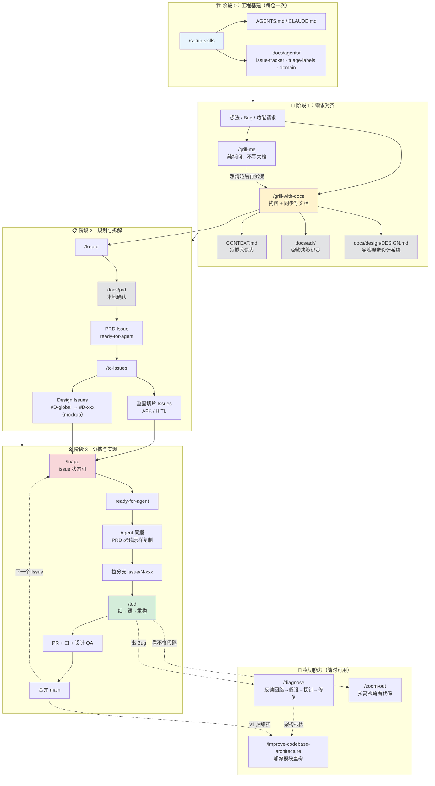

   
  <strong style="font-size: 2.8em;">AI写代码，真正受你控制。</strong>

一套把 AI Coding 做成<strong>可信交付</strong>的SOP：用可组合的 Agent Skills 管住全流程（需求对齐、规划、实现、排错、架构维护），每步留下<strong>可检查产物</strong>，告别 Vibe Coding。

> 作者：南哥 AGI 研习社（B站 / YouTube @南哥AGI研习社）

  

## 版本说明

| 版本           | 日期             | 作者  | 变更说明                                                                                                                                                               |
| ------------ | -------------- | --- | ------------------------------------------------------------------------------------------------------------------------------------------------------------------ |
| V1.0         | 2026-06-22     | 南哥  | 初始版本：Skills 中文化并融入实践经验；新增 UI 设计治理环节                                                                                                                                |
| V1.1         | 2026-06-24     | 南哥  | `/to-issues` 微调 Design Issue 初始状态；跟做案例定为宠物洗护门店预约核销系统                                                                                                               |
| **V1.2（当前）** | 2026-08-03（更新） | 南哥  | `/setup-skills` 四项基建；`/grill-with-docs` 固定拷问顺序与三种 UI 模式；`/to-prd` 本地确认 + 新 PRD 模板；`/to-issues` PRD 绑定 + States 矩阵；`/tdd` 强制 PRD 必检；**新增** `/repo-wiki` **代码库架构导读** |

当前推荐使用 `v1.2/` 目录。Skills 安装路径：`v1.2/skills/`。

## AI Coding SOP相关视频

- B 站视频合集：[https://www.bilibili.com/video/BV1zQNM6MEqf/](https://www.bilibili.com/video/BV1zQNM6MEqf/)
- YouTube 视频合集：[https://www.youtube.com/playlist?list=PLRsjhp02BBRE](https://www.youtube.com/playlist?list=PLRsjhp02BBRE)

## 文档目录（`v1.2/`）

| 目录 / 文件         | 内容                                        |
| --------------- | ----------------------------------------- |
| skills/         | 全部 Agent Skills 定义                        |
| AI编程SOP规范_v1.2/ | 规范梳理：Skills 全景图、TDD、UI 设计治理、**Repo Wiki** |
| 实践跟做指南汇总_v1.2/  | 保姆级跟做：从零开发、开源二次开发、若依二次开发                  |

## 全流程 Skill 地图

## 文档分层（规范 vs 导航）

| 层   | 路径                                                        | 读者        | 作用                        |
| --- | --------------------------------------------------------- | --------- | ------------------------- |
| 规范层 | `CONTEXT.md` · `docs/adr/` · `docs/design/` · PRD + Issue | 人 + Agent | 应该怎么做                     |
| 导航层 | `docs/repo-wiki/`                                         | **主要供人**  | 代码长什么样（`/repo-wiki` 扫描生成） |

## Skills 一览表

| Skill                            | 阶段      | 一句话                                                   | 产出物                                |
| -------------------------------- | ------- | ----------------------------------------------------- | ---------------------------------- |
| `/hi-ai-coding`                  | 入门      | 零基础 AI Coding 认知引导：是什么、vs Vibe 与可控、工程常识、协作方式、SOP全流程导览 | 认知报告（同意后落盘）                        |
| `/setup-skills`                  | 基建      | 配置 Issue 跟踪器、Triage 标签、领域文档、**Repo Wiki 布局**          | `docs/agents/`*                    |
| `/repo-wiki`                     | 基建 / 维护 | 扫描代码库，生成带源码位置标注的架构导读                                  | `docs/repo-wiki/`                  |
| `/grill-me`                      | 对齐      | 纯拷问，压力测试想法                                            | 对话共识（不写文件）                         |
| `/grill-with-docs`               | 对齐      | 拷问 + 实时写文档 + 定 UI 模式 + 品牌视觉规范                         | `CONTEXT.md` / ADR / `DESIGN.md`   |
| `/to-prd`                        | 规划      | 会话 → 先写 `docs/prd` 确认 → 发布 PRD Issue                  | PRD（含状态策略、页面清单、app-shell）          |
| `/to-issues`                     | 规划      | PRD → 垂直切片 Issues（不重新拆 UI 页）                          | 功能 Issue + Design Issue + UI Issue |
| `/triage`                        | 协作      | Issue 分拣、写 Agent 简报（含 PRD 必读）                         | 状态标签 + 评论                          |
| `/tdd`                           | 实现      | 红-绿-重构，预检 PRD 必读后逐条循环                                 | 代码 + 测试 + PR（UI 须过设计 QA）           |
| `/diagnose`                      | 排错      | 反馈回路 → 假设 → 探针 → 修复                                   | 回归测试                               |
| `/zoom-out`                      | 理解      | 拉高视角，画模块调用图（对话内临时）                                    | 架构地图（对话）                           |
| `/improve-codebase-architecture` | 维护      | 找「加深模块」重构机会 + UI Token 合规检查                           | HTML 架构报告（临时目录）                    |

