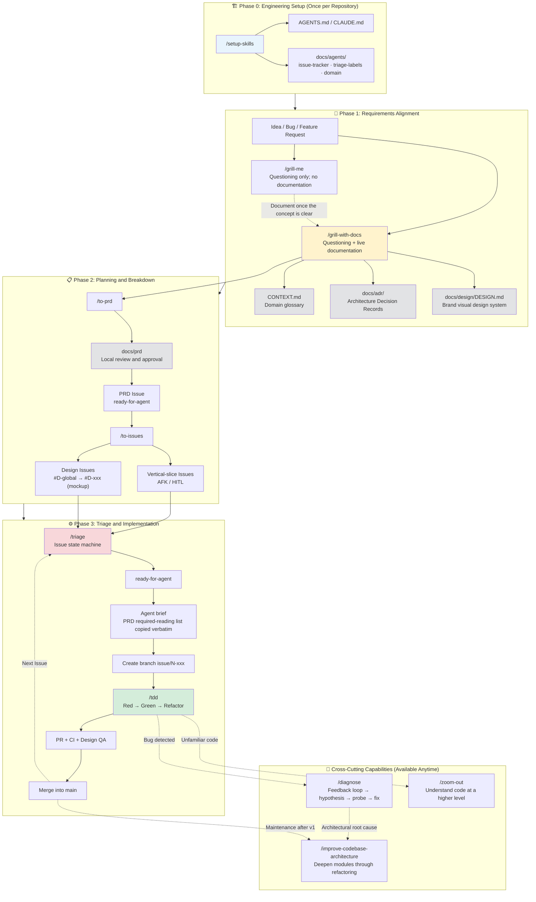

# AI-powered coding, truly under your control.

A standard operating procedure (SOP) for turning AI coding into <strong>reliable delivery</strong>: use composable Agent Skills to govern the entire workflow (requirements alignment, planning, implementation, debugging, and architecture maintenance), producing <strong>verifiable deliverables</strong> at every step. Move beyond Vibe Coding.

# End-to-End SOP for AI Coding Assistants

## End-to-End Skill Map

## Documentation Layers (Specification vs Navigation)

| Layer | Paths | Audience | Purpose |
| --- | --- | --- | --- |
| Specification layer | `CONTEXT.md` · `docs/adr/` · `docs/design/` · PRD + Issues | Humans + Agents | How the system should be built and behave |
| Navigation layer | `docs/repo-wiki/` | **Primarily humans** | How the codebase is structured (generated by scanning with `/repo-wiki`) |

## Skills Overview

| Skill | Phase | Summary | Deliverables |
| --- | --- | --- | --- |
| `/hi-ai-coding` | Onboarding | Beginner-friendly introduction to AI coding: what it is, Vibe Coding vs controlled development, engineering fundamentals, collaboration, and the end-to-end SOP | Learning report (saved upon approval) |
| `/setup-skills` | Setup | Configure the Issue tracker, triage labels, domain documentation, and **Repo Wiki layout** | `docs/agents/`* |
| `/repo-wiki` | Setup / Maintenance | Scan the codebase and generate an architectural guide with references to source locations | `docs/repo-wiki/` |
| `/grill-me` | Alignment | Question and stress-test ideas without writing documentation | Agreed conclusions in conversation (no files) |
| `/grill-with-docs` | Alignment | Questioning + live documentation + UI mode selection + brand visual standards | `CONTEXT.md` / ADR / `DESIGN.md` |
| `/to-prd` | Planning | Conversation → draft in `docs/prd` for local review → publish as a PRD Issue | PRD (including state strategy, page inventory, and app-shell) |
| `/to-issues` | Planning | PRD → vertical-slice Issues (without re-splitting UI pages) | Feature Issues + Design Issues + UI Issues |
| `/triage` | Collaboration | Triage Issues and write Agent briefs (including mandatory PRD reading) | Status labels + comments |
| `/tdd` | Implementation | Red–Green–Refactor; run mandatory PRD prechecks before iterative implementation | Code + tests + PR (UI work also requires Design QA) |
| `/diagnose` | Debugging | Feedback loop → hypothesis → probe → fix | Regression tests |
| `/zoom-out` | Understanding | Take a higher-level view and draw module call diagrams (temporary, in conversation) | Architecture map (in conversation) |
| `/improve-codebase-architecture` | Maintenance | Identify opportunities to deepen modules through refactoring and check UI token compliance | HTML architecture report (temporary directory) |
